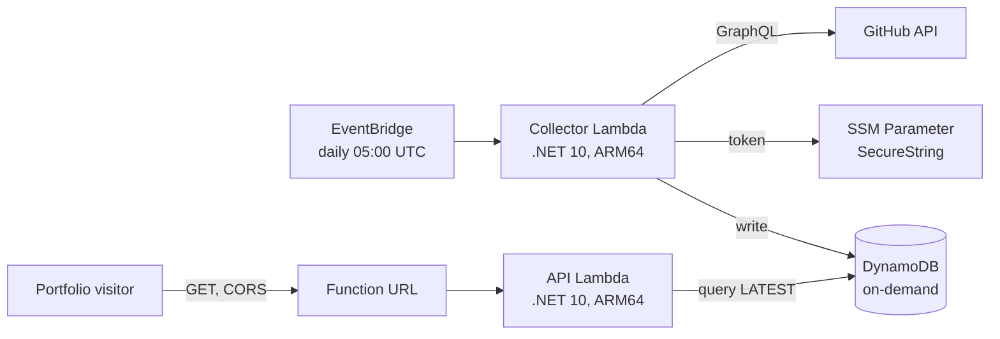

# Engineering Metrics

[](https://github.com/bobdigi80/engineering-metrics/actions/workflows/ci.yml)

A small serverless service that measures how quickly pull requests get reviewed and merged in public GitHub repositories, and publishes the results as JSON for [ianpotts.dev](https://ianpotts.dev).

As an engineering manager I cut my team's PR review turnaround by about 20%. This is the kind of tool I would want for measuring that: small, cheap to run, tested, and honest about its trade-offs.

## What it measures

For pull requests merged in the last 30 days, per repository:

| Metric | Definition |
|---|---|
| Time to first review | PR opened → first submitted review by someone other than the author. Median and p90. |
| Cycle time | PR opened → merged. Median and p90. |
| PR size | Lines added + deleted. Median. |
| Reviewed share | Fraction of merged PRs that had at least one review before or after merging. |

Bot-authored PRs (e.g. Dependabot) are excluded, and bot reviews don't count as a first review, because both skew the numbers. Percentiles use linear interpolation (the same as Excel's `PERCENTILE.INC`).

## Architecture



Decisions and the alternatives considered are in [`docs/adr`](docs/adr):

1. [Record architecture decisions](docs/adr/0001-record-architecture-decisions.md)
2. [Serverless: Lambda and DynamoDB](docs/adr/0002-serverless-lambda-and-dynamodb.md)
3. [Use the GitHub GraphQL API](docs/adr/0003-github-graphql-api.md)
4. [Lambda Function URL instead of API Gateway](docs/adr/0004-function-url-instead-of-api-gateway.md)
5. [Cost guardrails and keyless deploys](docs/adr/0005-guardrails-oidc-and-budget.md)

## Project layout

```
src/
  EngineeringMetrics.Core        Domain: pull request model, metrics calculation, store interfaces. No AWS dependencies.
  EngineeringMetrics.Storage     DynamoDB implementation of the store.
  EngineeringMetrics.Collector   Scheduled Lambda: GitHub GraphQL client, collection run.
  EngineeringMetrics.Api         Function URL Lambda: serves the latest snapshots.
infra/
  EngineeringMetrics.Infra       AWS CDK app in C#: application stack and guardrails stack.
tests/
  EngineeringMetrics.Tests       xUnit tests for the calculator, GitHub mapping, collector and API.
docs/adr/                        Architecture decision records.
```

The Lambda entry points (`Function.cs`) only read configuration and wire dependencies together. Everything else takes its dependencies through constructors, so it is tested without AWS or the network.

## API

`GET /` (or `/metrics`) returns the latest snapshot for each repository (example values):

```json
{
  "repositories": [
    {
      "repository": "microsoft/aspire",
      "generatedAt": "2026-11-15T05:00:02+00:00",
      "windowDays": 30,
      "mergedPullRequests": 48,
      "medianHoursToFirstReview": 3.2,
      "p90HoursToFirstReview": 27.5,
      "medianCycleTimeHours": 21.4,
      "p90CycleTimeHours": 140.8,
      "medianSize": 86,
      "reviewedShare": 0.96
    }
  ]
}
```

`GET /history?repository=owner/name` returns up to 90 days of daily snapshots for one repository, oldest first, as `{ "repository": "...", "snapshots": [ ... ] }` with the same fields.

Responses are cacheable for an hour. CORS allows the origins in `cdk.json`.

## Running locally

Requires the .NET 10 SDK and Node.js 22+.

```
dotnet test
```

To check the infrastructure without deploying:

```
dotnet publish src/EngineeringMetrics.Collector -c Release -o artifacts/collector
dotnet publish src/EngineeringMetrics.Api -c Release -o artifacts/api
npm ci
npx cdk synth
```

## Deploying

### One-time setup

1. **Bootstrap CDK** in your account and region: `npx cdk bootstrap`
2. **Store a GitHub token.** Create a fine-grained personal access token with read-only access to public repositories, then:
   ```
   aws ssm put-parameter --name /engineering-metrics/github-token --type SecureString --value <token>
   ```
3. **Deploy the guardrails** (budget alert and the GitHub Actions deploy role). The email is passed on the command line so it is never committed:
   ```
   npx cdk deploy EngineeringMetricsGuardrails -c budgetEmail=you@example.com
   ```
   If the account already has a GitHub OIDC provider, add `-c createOidcProvider=false`.

   The deploy role only trusts this repository's `main` branch. If you fork this, set `githubRepository` and `githubOidcSubjectPrefix` in `cdk.json`; the prefix is the `sub_claim_prefix` from `gh api repos/OWNER/NAME/actions/oidc/customization/sub` (newer repositories use immutable IDs, e.g. `repo:owner@123/name@456`).
4. **Configure GitHub.** In the repository's Settings → Secrets and variables → Actions → Variables, add:
   - `AWS_DEPLOY_ROLE_ARN`: the `DeployRoleArn` output from step 3
   - `AWS_REGION`: e.g. `eu-west-2`

5. **Subscribe to failure alerts** (optional). The application stack has an alarm that fires when a collector run fails. To get it by email, subscribe to the `AlertsTopicArn` stack output and confirm the email AWS sends:
   ```
   aws sns subscribe --topic-arn <AlertsTopicArn> --protocol email --notification-endpoint you@example.com
   ```

### From then on

Every push to `main` runs the build, the tests and `cdk synth`, then deploys the application stack. Pull requests run everything except the deploy.

To deploy by hand: publish both Lambdas (see above), then `npx cdk deploy EngineeringMetrics`.

To change which repositories are measured, edit `repositories` in `cdk.json`.

## Cost

At portfolio traffic, everything is pay-per-use and expected to cost well under $1 a month: Lambda requests and compute fall inside the always-free tier, DynamoDB on-demand handles a few writes a day, and logs are kept for two weeks. The guardrails stack adds a $5 monthly budget with email alerts as a backstop, and the public API Lambda is limited to five concurrent executions so abuse of the URL cannot run up a bill.

## License

[MIT](LICENSE)
